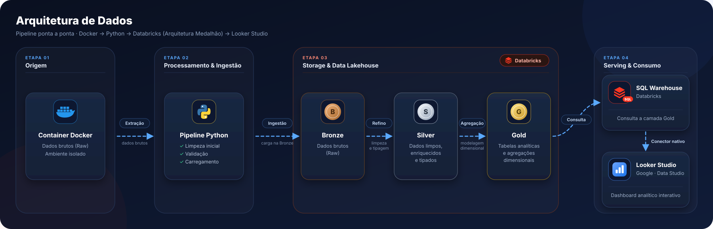

# Cyclistic Bike-Share: Arquitetura Lakehouse & BI Analytics

[](https://databricks.com/)
[](https://delta.io/)
[](https://python.org/)
[](https://lookerstudio.google.com/)

> Pipeline analítico *end-to-end* projetado para ingestão, processamento e modelagem dimensional de mais de **26 milhões de registros** públicos do serviço de compartilhamento de bicicletas Cyclistic (Divvy Bikes, Chicago). A solução evoluiu de uma análise exploratória inicial em [R](https://github.com/andrealmeidags/Projeto-Analise-Cyclistic_R) para uma arquitetura escalável de **Lakehouse Medalhão com Databricks, Delta Lake, SQL Warehouse e Looker Studio**.

---

## 🔗 Links e Recursos do Projeto

* 📊 **[Dashboard Interativo no Looker Studio](https://datastudio.google.com/reporting/c82a823d-8c2a-43fd-8755-ba62f1ce7d1b)**


---

## 🏛️ Arquitetura da Solução

O pipeline foi estruturado seguindo as melhores práticas de Lakehouse moderno, garantindo linhagem de dados, confiabilidade e consultas com performance de subsegundo no BI:

<p align="center">
  
</p>

### Detalhes das Camadas:

* **Bronze (Raw Zone):** Ingestão particionada dos dados históricos brutos em tabelas Delta Lake nativas via Databricks Unity Catalog.
* **Silver (Refined Zone):** 
  * Limpeza de dados nulos e inconsistências temporais (viagens negativas ou com duração superior a 24 horas).
  * Enriquecimento geoespacial: cálculo de distância geodésica ponto a ponto via fórmula de **Haversine**.
  * Extração de atributos temporais: dia da semana, mês, ano, hora do dia e partes do dia.
* **Gold (Curated / Analytics Zone):**
  * Tabela fato de viagens e tabela sumarizada pré-agregada.
  * **Otimização de BI:** Redução do volume de processamento de dezenas de milhões de linhas brutas para uma tabela analítica agregada de **apenas ~736 KB**, contornando limites de memória de ferramentas de visualização e eliminando custos desnecessários de computação em nuvem.

---

## 💡 Decisões Técnicas e Modelagem Dimensional

1. **Categorização de Distância por Distribuição Real:**
   * Segmentação estatística baseada nos quartis de distribuição ($P_{25}$, $P_{50}$ e $P_{75}$):
     * `Circular/Lazer`: $0\text{ km}$ (partida e chegada na mesma estação).
     * `Curta Distância`: até $1,0\text{ km}$.
     * `Média-Curta Distância`: $1,0\text{ a }1,7\text{ km}$.
     * `Média-Longa Distância`: $1,7\text{ a }2,9\text{ km}$.
     * `Longa Distância`: acima de $2,9\text{ km}$.
2. **Cálculo Rigoroso de Métricas Ponderadas:**
   * Para evitar a distorção da "média das médias" em tabelas agregadas no Looker Studio, a camada Gold expõe `SUM(total_minutos)` e `SUM(total_km)`. Os cartões de KPI utilizam média ponderada real:
     ```text
Duração Média = SUM(total_minutos) / SUM(qtd_viagens)
     ```
3. **Ordenação Lógica de Categorias:**
   * Chaves numéricas de ordenação (`id_distancia`, `id_duracao_viagem`) e padronização ordinal de dimensões garantem que os eixos gráficos sejam renderizados na ordem analítica correta.

---

## 📊 Estrutura do Dashboard Executivo

O relatório interativo é dividido em duas páginas:

* **Página 1: Perfil de Uso e Mobilidade:** Distribuição de volume por faixa de distância, duração de percurso, divisão por tipo de bicicleta e proporção entre membros anuais e usuários casuais.
* **Página 2: Padrões Temporais e Sazonalidade:** Comportamento temporal cruzando sazonalidade anual (meses de verão vs. inverno), preferência por dias úteis vs. fins de semana e curvas de utilização diária.

---

## 🎯 Principais Descobertas e Recomendações de Negócio

* **Uso Funcional vs. Lazer:** Usuários anuais (`members`) utilizam o serviço com foco funcional/transporte nos dias úteis, com durações mais curtas e regulares. Usuários casuais (`casual`) concentram seu volume nos fins de semana e no verão (junho a agosto), com trajetos significativamente mais longos.
* **Estratégia de Conversão:**
  * Campanhas sazonais direcionadas no início da primavera/verão focadas em usuários casuais recorrentes.
  * Planos de assinatura voltados para uso em fins de semana ou benefícios específicos para trajetos recreativos.

---

## 🛠️ Tecnologias e Ferramentas

| Categoria | Tecnologias |
| :--- | :--- |
| **Plataforma de Dados** | Databricks, Databricks Unity Catalog, Delta Lake |
| **Processamento & Linguagens** | Databricks SQL, Python, Docker |
| **Visualização & BI** | Google Looker Studio |
| **Modelagem & Metodologia** | Lakehouse Medalhão, Haversine Geospatial |